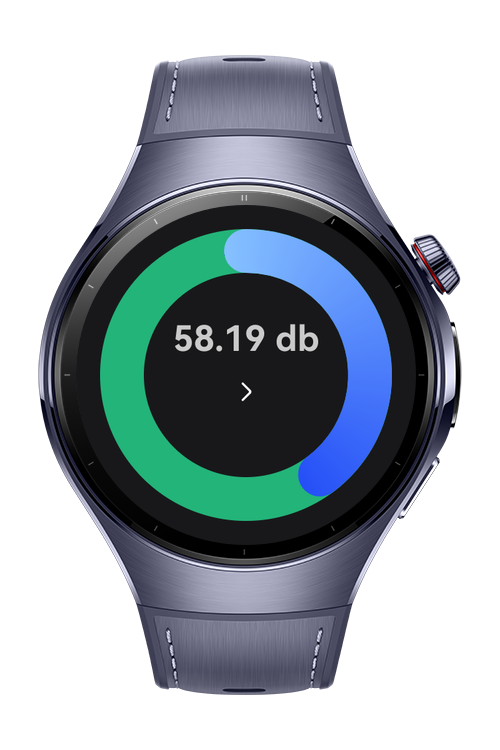
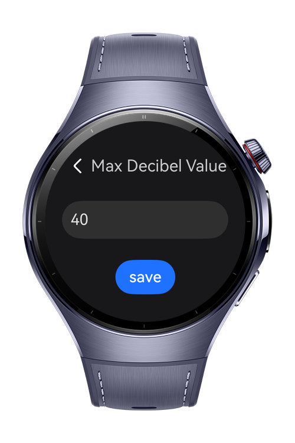
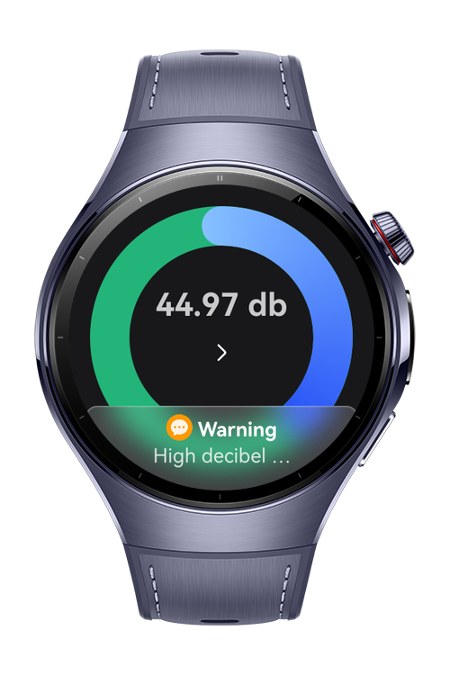

> **Note:** To access all shared projects, get information about environment setup, and view other guides, please visit [Explore-In-HMOS-Wearable Index](https://github.com/Explore-In-HMOS-Wearable/hmos-index).

# SoundDecibelMeter

Measure environmental sound levels (dB) on HarmonyOS Next (Huawei Watch 5). The app records short audio frames, computes decibels in real time, and visualizes the result with a smooth animated ring.

# Preview
<div>
  
  
  
</div>


# Use Cases
- Ambient noise monitoring (home/office/classroom)
- “Safe listening” checks (quick peaks)
- Visualizing sound intensity during activities
- Live dB meter — real-time decibel computation with smoothing - 
- Animated ring UI — center value + circular progress (ScaleRing/Ring)
- Watch-first UX — optimized for Huawei Watch 5
- Permission-safe — asks MICROPHONE only when needed
- Modular MVVM — clear separation of view / view model / core helpers
- Lightweight logging — pluggable LogManager for diagnostics

# Technology

## Stack
- **Languages**: ArkTS, ArkUI
- **Frameworks**: HarmonyOS SDK 5.1.0(18)
- **Tools**: DevEco Studio Version 5.1.0.828
- **Libraries**:
    - `@kit.AudioKit`
    - `@kit.AbilityKit`
    - `@kit.PerformanceAnalysisKit`
    - `@kit.CoreFileKit`
    - `@kit.NotificationKit`

## Required Permissions
- `ohos.permission.MICROPHONE`
  > Required for audio recording functionality during note creation.

# Directory Structure

```
├───core
│   ├
│   ├─── logger
│   │   └─── LogManager.ets
│   ├─── navigation
│   │   └─── NavigationManager.ets
│   ├─── permission
│   │   └─── PermissionManager.ets
│   ├
├───feature
│   ├─── splash
│   ├       └───component
│   │              └─── ProgressComponent.ets
│   │       └───state
│   │              └─── ISplashState.ets
│   │              └─── SplashState.ets
│   │       └─── view
│   │               └─── SplashView.ets
│   │       └─── viewmodel
│   │               └─── SplashViewModel.ets
│   │               └─── ISplashState.ets
│   │               └─── SplashState.ets
│   ├
│   ├─── dashboard
│   ├       └───component
│   │              └─── AnimatedProgressButton.ets
│   │       └───state
│   │              └─── IDashboardState.ets
│   │              └─── DashboardState.ets
│   │       └─── view
│   │               └─── DashboardView.ets
│   │       └─── viewmodel
│   │               └─── DashboardViewModel.ets
│   │               └─── IDashboardState.ets
│   │               └─── DashboardState.ets
│   ├─── dashboard
│   ├       └───model
│   │              └─── SettingsModel.ets
│   │       └───state
│   │              └─── ISettingsState.ets
│   │              └─── SettingsState.ets
│   │       └─── view
│   │               └─── SettingsView.ets
│   │       └─── viewmodel
│   │               └─── SettingsViewModel.ets
│   │               └─── ISettingsState.ets
│   │               └─── SettingsState.ets
│   │   
│   ├─── pages
│   │   └─── Index.ets
│   │   
```

# Constraints and Restrictions
## Supported Device

* Huawei Watch 5

# License

**SoundDecibelMeter** is distributed under the terms of the MIT License

See the [LICENSE](./LICENCE) for more information.
